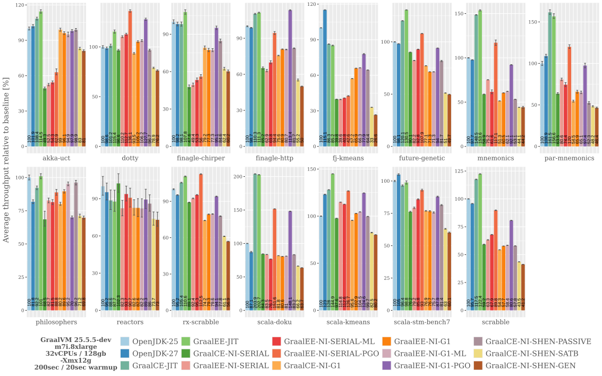
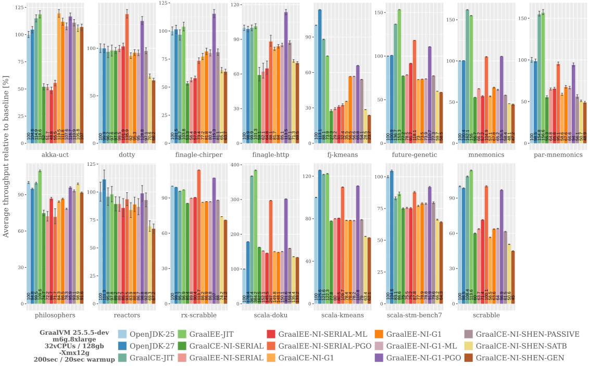

# Renaissance Benchmarks for Graal Native Image

This repository provides some scripts for running a compatible subset of the  Renaissance benchmarks as Graal native images and compares the performance of OpenJDK's HotSpot JVM with various GraalVM and GraalVM Native Image configurations.

The results for OpenJDK 25/27 and GraalVM 25.5.5-dev look as follows (click on the image for a larger version):

[](https://raw.githubusercontent.com/simonis/RenaissanceNI/refs/heads/main/output/results/2026-10-18-14-41-35/Graal25.5.5-dev_G1-meta.svg)

In this graph, the labels for the JVM implementation have the following meaning:
- OpenJDK-25: plain OpenJDK 25 running with the default C2/G1 configuration
- OpenJDK-27: plain OpenJDK 27 running with the default C2/G1 configuration
- GraalCE-JIT: GraalVM 25.5.5-dev Community edition with the Graal JIT (i.e. "libgraal") running as high tier JIT and the default G1 collector.
- GraalEE-JIT: Oracle GraalVM 25.4.4.1.1 (formerly known as "Enterprise Edition) with the Graal JIT (i.e. "libgraal") running as high tier JIT and the default G1 collector.
- GraalCE-NI-SERIAL: Native image produced by the GraalVM 25.5.5-dev Community edition (running with the default Serial GC).
- GraalCE-NI-G1: Native image produced by the GraalVM 25.5.5-dev Community edition (running with the [development version of G1 GC](https://github.com/graalvm/labs-openjdk/tree/chaeubl/GR-77360)).
- GraalCE-NI-SHEN-PASSIVE: Native image produced by the GraalVM 25.5.5-dev Community edition (running with a [development version of Shenandoah GC in stop-the-world mode (i.e. `-H:ShenandoahGCMode=passive`))](https://github.com/simonis/labs-openjdk/tree/simonis/GR-77360-GenShen)).
- GraalCE-NI-SHEN-SATB: Native image produced by the GraalVM 25.5.5-dev Community edition (running with a [development version of Shenandoah GC in concurrent mode (i.e. `-H:ShenandoahGCMode=satb`))](https://github.com/simonis/labs-openjdk/tree/simonis/GR-77360-GenShen)).
- GraalCE-NI-SHEN-Gen: Native image produced by the GraalVM 25.5.5-dev Community edition (running with a [development version of Shenandoah GC in generational mode (i.e. `-H:ShenandoahGCMode=generational`))](https://github.com/simonis/labs-openjdk/tree/simonis/GR-77360-GenShen)).
- GraalEE-NI-SERIAL: Native image produced by Oracle GraalVM 25.4.4.1.1 (running with the default Serial GC and without automatic, ML-powered, profile guided optimizations (PGO), i.e. `-H:-MLProfileInference`).
- GraalEE-NI-ML: Native image produced by Oracle GraalVM 25.4.4.1.1 (running with the default Serial GC and automatic, Machine Learning powered, profile guided optimizations (PGO)).
- GraalEE-NI-PGO: Native image produced by Oracle GraalVM 25.4.4.1.1 (running with the default Serial GC and explicit, profile guided optimizations (PGO), i.e. training run).
- GraalEE-NI-G1: Native image produced by Oracle GraalVM 25.4.4.1.1 (running with G1 GC and without automatic, ML-powered, profile guided optimizations (PGO), i.e. `-H:-MLProfileInference`).
- GraalEE-NI-G1-ML: Native image produced by Oracle GraalVM 25.4.4.1.1 (running with G1 GC and automatic, Machine Learning powered, profile guided optimizations (PGO)).
- GraalEE-NI-G1-PGO: Native image produced by Oracle GraalVM 25.4.4.1.1 (running with the G1 GC and explicit, profile guided optimizations (PGO), i.e. training run).

The above numbers were collected on a [m7i.8xlarge](https://aws.amazon.com/de/ec2/instance-types/m7i/) instance with 32 Intel Xeon vCPUs and 128gb RAM using [Renaissance 0.16.1](https://renaissance.dev/download). All benchmarks were run with `-Xms12g -Xmx12g` for 200 seconds and in the graph the results within the first 20 seconds were discarded to accommodate for warmup. The native images were compiled with `-O3`.

The following picture shows the results for the same configuration collected on a [m6g.8xlarge](https://aws.amazon.com/de/ec2/instance-types/m6g/) instance with 32 Graviton 2 vCPUs and 128gb RAM.

[](https://raw.githubusercontent.com/simonis/RenaissanceNI/refs/heads/main/output/results/2026-10-18-14-43-05/Graal25.5.5-dev_aarch64_G1-meta.svg)


## Observations

The first four columns in each subgraph represent HotSot executions with JDK 25 C2, JDK 27 C2, Graal CE and Graal EE JIT respectively (all using G1 GC by default). The results are quite similar to those which are published on the [original Renaissance website](https://renaissance.dev/) for JDK 23. Since the [last measurements with GraalVM 25](./results_GraalVM_25.md) the Graal CE JIT has considerably improved and now beats C2 in many cases. Although a lot of the former exclusive EE features have been open sourced and integrated into the CE version, the Graal EE JIT is still slightly faster compared to CE most of the time.

Oracle Graal NI with PGO and either Serial of G1 GC (depending on the GC characteristics of the benchmark) performs really well and is on par or even faster compared to the HotSpot C2/G1. However, Graal Community Edition NI with the development versions of G1 and Shenandoah has considerably caught up since EE features like XXX have been integrated into the community version.

While it is interesting to see that for specific benchmarks like e.g. *future-genetics* or *reactors* with serial GC and *dotty*, *akka* or *scala-kmeans* with G1 GC the CE version performs even slightly better than the EE version, in general the corresponding EE versions are still faster compared to their CE counterparts.

The biggest remaining gap between Oracle GraalVM and GraalVM CE is clearly Profiling Guided Optimization (PGO) which for some benchmarks like e.g. *mnemonics*, *scala-docu* or *scrabble* can make a difference of up to 50% or more.

The first development version of Shenandoah performs quite well although these Renaissance benchmarks are mostly throughput-oriented benchmarks where the additional overhead introduces by Shenandoah's Load Reference Barriers (LRB) is significant. This can be seen by the fact that Shenandoah in stop-the-world mode (i.e. `-H:ShenandoahGCMode=passive`), which doesn't require any barriers at all, performs much better. While there's probably still some optimization potential to improve Shenandoah's barrier performance, internal tests with the more latency-oriented SPECjbb2015 already show promising results and superior "critical j-OPS" numbers compared to G1 GC.

## Details on running the benchmarks

Graal actually has built-in (i.e. into `mx`) support for running the Renaissance benchmarks and only [excludes "chi-square", "gauss-mix", "page-rank" and "movie-lens"](https://github.com/oracle/graal/blob/70b9a98abc80bbdc54145dd84edfbfe94b6e836b/sdk/mx.sdk/mx_sdk_benchmark.py#L3878-L3882) from the full benchmark set. There's also special support for building native images versions of the benchmarks in [mx_substratevm_benchmark.py](https://github.com/oracle/graal/blob/a14af8cc6a27c4138083dfb28db5b6c2b5a9d881/substratevm/mx.substratevm/mx_substratevm_benchmark.py#L69-L148). Unfortunately, this support seems to be broken for a few more benchmarks. According to current information (i.e. Feb. 12, 2026) from the [Graal Native Image Slack channel](https://graalvm.slack.com/archives/CN9KSFB40/p1770839392854859) the following Renaissance benchmarks are known to currently work with Native Image: *akka-uct*, *dotty*, *finagle-chirper*, *finagle-http*, *fj-kmeans*, *future-genetic*, *mnemonics*, *par-mnemonics*, *philosophers*, *reactors*, *rx-scrabble*, *scala-doku*, *scala-kmeans*, *scala-stm-bench7*, *scrabble*. These are the benchmarks further considered here.

[Renaissance 0.14](https://renaissance.dev/2022/01/31/renaissance-0-14-0.html) introduced the so called "[*standalone mode*](https://renaissance.dev/posts#standalone-mode)" which executes a benchmark without the help of the launcher in the main Renaissance bundle. The benchmark harness is still used, but both the harness and benchmark code are loaded using a single class loader. The benchmark bundle (i.e. ` renaissance-gpl-0.16.1.jar`) needs to be manually extracted. In addition to directories containing the benchmark and dependency jars, it also contains metadata-only jars (one for each benchmark) in a directory called `single/`. These jars can be used to execute the corresponding benchmark in standalone mode simply by running `java -jar single/<benchmakr>.jar` or to create a native image for them with `native-image -o <benchmark>.exe -cp single/<benchmakr>.jar org.renaissance.harness.RenaissanceSuite` which can then be executed as `<benchmark>.exe <benchmark>`,

The script [./scripts/renaissanceNI.sh](./scripts/renaissanceNI.sh) handles this automatically. For HotSpot execution it just runs the benchmarks as described above. For the native image case it first runs each benchmark on HotSpot with the native image agent in order to collect the required reachability metadata and then created the native image version of each benchmarks. For the profile guided optimizations modes (PGO) it adds another intermediate step to first create an instrumented native image and run it in order to collect the PGO data which is then used in the final build step of the actual native image.

The script can be configured with environment variables, many of which are mandatory and will let the script fail if not defined:

Name | Mandatory | Default | Description
:--- | :-------: | :-----: | :----------
`OPENJDK_25_HOME` | &check; | &cross; | Directory where to find a plain OpenJDK 25 distribution |
`OPENJDK_LATEST_HOME` | &check; | &cross; | Directory where to find a plain OpenJDK 27 distribution |
`GRAALCE_HOME` | &check; | &cross; | Directory where to find a Graal CE distribution built with G1 and shenadoah support from my [labs-openjdk `simonis/GR-77360-GenShen`](https://github.com/simonis/labs-openjdk/tree/simonis/GR-77360-GenShen) and [graalvm `simonis/GR-70306-upstream`](https://github.com/simonis/graal/tree/simonis/GR-70306-upstream) branches |
`GRAALEE_HOME` | &check; | &cross; | Directory where to find an Oracle Graal distribution |
`RENAISSANCE_SINGLE` | &check; | &cross; | The `single/` subdirectory of an unpacked Renaissaince benchmark `.jar` file |
`OUTPUT` | &cross; | `RenaissanceNI/output` | Directory where to place the artifacts produced by the script. All the benchmarks results (i.e. `.json` files) of a single script run are placed under ``${OUTPUT}/results/`date +%Y-%m-%d-%H-%M-%S`/<benchmark>``. The generated artifacts (i.e. native images and PGO files) are placed under `${OUTPUT}/<benchmark>` and the reachability metadata under `${OUTPUT}/<benchmark>/conf`. Non existing directories will be created. |
`REBUILD_CONF` | &cross; | unset | If set, the reachability metadata will be re-computed at each run, even if it already exists for a benchmark. |
`REBUILD_NI` | &cross; | unset | If set, the native images and PGO data will be re-build at each run, even if it already exists for a benchmark. |
`JAVA_ARGS` | &cross; | `-Xms12g -Xmx12g` | Can be used to pass command line arguments to all benchmark runs (HotSpot and Native Image) |
`BENCH_TIME` | &cross; | `600` | The benchmark execution time in seconds. Will be passed with `-t` to each benchmark execution. |
`BENCHMARKS` | &cross; | all benchmarks | A comma-separated list of benchmarks to execute. By default all benchmarks which are known to work as Native Image (i.e. *akka-uct*, *dotty*, *finagle-chirper*, *finagle-http*, *fj-kmeans*, *future-genetic*, *mnemonics*, *par-mnemonics*, *philosophers*, *reactors*, *rx-scrabble*, *scala-doku*, *scala-kmeans*, *scala-stm-bench7*, *scrabble*) will be executed. |
`FINAGLE_CHIRPER_MAX_CPUS` | &cross; | unset | *finagle-chirpher* becomes [unstable and can throw exceptions](https://github.com/renaissance-benchmarks/renaissance/issues/231) if it is running on a machine with too many cores. With this option, the numbers of cores used for the benchmark can be restricted. |


If *dotty* is run as native image, it needs this special command line arguments `-Djava.home` and `-Djava.class.path` which will be set automatically by the script.

## Creating the output graphs

For creating the graph with the benchmarks results I [used my own, slightly adapted version](https://github.com/simonis/utilities-r/tree/RenaissanceNI) of the [original Renaissance `utilities-r` scripts](https://github.com/renaissance-benchmarks/utilities-r). Before we can use these scripts, we first have to pre-process the generated `.json` files a little bit. Because we need some extra command line arguments for certain benchmarks, the `utilities-r` scripts will treat those executions as if they were run with a different JVM and create a new column for them in the generated graph. In order to fix this problem without bigger changes in the R scripts themselves, we simply strip those extra argument from the result files with:

```bash
$ ./scripts/strip_results.sh ./output/results/ json ', "-Djava.home=.*-Djava.class.path=.*"' ""
$ ./scripts/strip_results.sh ./output/results/ json ', "-XX:ActiveProcessorCount=48"' ""
```

The second invocation is only required if you have use `FINAGLE_CHIRPER_MAX_CPUS` and the pattern should be adapted accordingly.

Never versions of GraalVM Native Image also [have a bug](https://github.com/oracle/graal/pull/14624) which prevents them from correctly exporting `-Dproperty=value` command line arguments through `RuntimeMXBean::getInputArguments()`. The `scripts/fix_results.sh` inserts the correct `-Dmode=<mode>` properties into the generated `.json` result files based on the corresponding directories they are saved in. This is necessary for the R scripts to correctly assign the results to the correct Native Image runs (e.g. `GraalCE-NI-SERIAL`, etc.):

```bash
$ ./scripts/fix_results.sh ./output/results/
```

Once we have prepared the results, we can clone [my version of `utilities-r`](https://github.com/simonis/utilities-r/tree/RenaissanceNI)
and use them as follows:

```bash
$ git clone https://github.com/simonis/utilities-r
$ cd utilities-r
$ git checkout RenaissanceNI
$ R
```
```R
# Install pak if it is not already installed
> install.packages("pak")
# Build and install the rren package
> pak::pak('.')
...
? Do you want to continue (Y/n)
✔ Got rren 0.1.2 (source) (4.10 kB)
ℹ Packaging rren 0.1.2
✔ Packaged rren 0.1.2 (948ms)
ℹ Building rren 0.1.2
✔ Built rren 0.1.2 (4s)
✔ Installed rren 0.1.2 (local) (1s)
✔ 1 pkg + 47 deps: kept 46, upd 1, dld 1 (NA B) [31.3s]
# Load the results into a dataset
> renaissance <- rren::load_path_json("./output/results")
# Create default labels from the dataset
> labels <- rren::plot_default_labels(renaissance)
# Write the labels into a CSV file and edit them accordingly (e.g. set 'vm_label' and 'vm_jdk')
> readr::write_csv(labels, "./output/results/labels_all.csv")
# Create the graph. Discard all measurements in the first 'warmup' seconds
# This will create a file 'stripe-jdk-<vm_jdk>.svg' in the current directory.
> rren::plot_website_stripes(renaissance, warmup=180, labels="./output/results/labels_all.csv", \
                             palette='Paired', name='GraalVM_25.4.4.svg', \
                             label_prefix='GraalVM 25.5.5-dev\nm7i.8xlarge\n32vCPUs / 128gb\n-Xmx12g\n200sec / 20sec warmup'))
```
